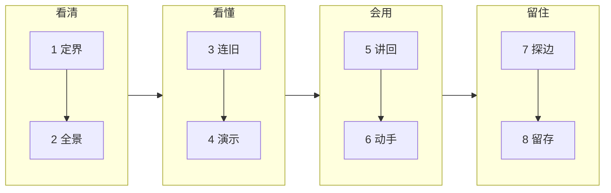

# be-better-engineers

成为更好的工程师。

AI 比我们懂得更广、更深之后，工程师要回答两个问题：**出路在哪**，以及**怎么更快地学会新东西**。这个仓库各给一个答案。

| 内容 | 是什么 |
|---|---|
| [docs/career.md](docs/career.md) | **出路**。什么在降价、什么在涨价，经验里哪部分值钱，五条路各靠什么、第一步做什么 |
| [skills/learn](skills/learn/SKILL.md) | **学习 skill**。让 Claude 按一套固定的流程教你学会一样新东西，以图为主，并且每一步都要你自己动手 |
| [examples/consistent-hashing.html](examples/consistent-hashing.html) | 学习 skill 生成的一页学习页，主题是一致性哈希。下载后用浏览器打开 |

## 学习 skill 做什么

拿到答案和学会是两件事。读完一段讲解，人几乎总觉得懂了，过两天却讲不出来，换个情况也不会用。

这个 skill 把学会一样东西拆成四个阶段、八步：



- **先定边界和深度**。不是每样东西都值得学深。开始前先定这次学到哪一层：知道有、能验，还是能做。
- **先选图，再配字**。范围用边界图，关系用概念图，过程用时序图，对比用对照表。文字只说图说不了的。
- **每一步都要你出力**。先猜再讲，学完自己讲一遍，再做一道没见过的题，过几天回来复习。
- **说清楚核对到了什么程度**。每个关键说法标明是实际验证过的、通用知识，还是推测。

可以在对话里一步一步学，也可以生成一页能反复打开的学习页：概念图能点，演示能一步步放，小测能作答，复习日期会记下来。生成的页面会先过一遍检查脚本，确认没有报错、没有溢出、深色模式下看得清。

## 安装

**作为 Claude Code 插件**，在 Claude Code 里运行：

```
/plugin install be-better-engineers --marketplace qiaob/be-better-engineers
```

旧版本的 Claude Code 分两步：

```
/plugin marketplace add qiaob/be-better-engineers
/plugin install be-better-engineers@be-better-engineers
```

**只要这个 skill**：把 `skills/learn` 整个目录复制到 `~/.claude/skills/learn`。

装好后直接说你想学什么就行，比如：

- 「我想搞懂 Raft 是怎么选主的，学到能判断别人方案靠不靠谱就行」
- 「刚才 AI 说问题出在连接池，我完全没往那边想过，想弄明白」
- 「帮我做一页学习页，讲数据库事务的隔离级别」

生成学习页需要 Python 3；检查学习页需要 Node.js，装了 Playwright 时还会用浏览器实际打开检查。

## 目录

```
docs/career.md                    出路
skills/learn/
  SKILL.md                        流程和规则
  references/steps.md             八步各自怎么做，以及背后的研究
  references/visuals.md           每种图怎么画（Mermaid 和字符画）
  references/page-data.md         学习页的数据怎么写
  references/example-lesson.js    一份完整的学习页数据
  references/records.md           「没想到」清单和学习记录
  scripts/build_page.py           把数据填进模板，生成学习页
  scripts/check_page.cjs          检查生成的学习页
  assets/learning-page.html       学习页模板
  evals/                          测试用例：在 skills/learn 目录下运行 claude plugin eval .
examples/                         生成好的学习页
```
