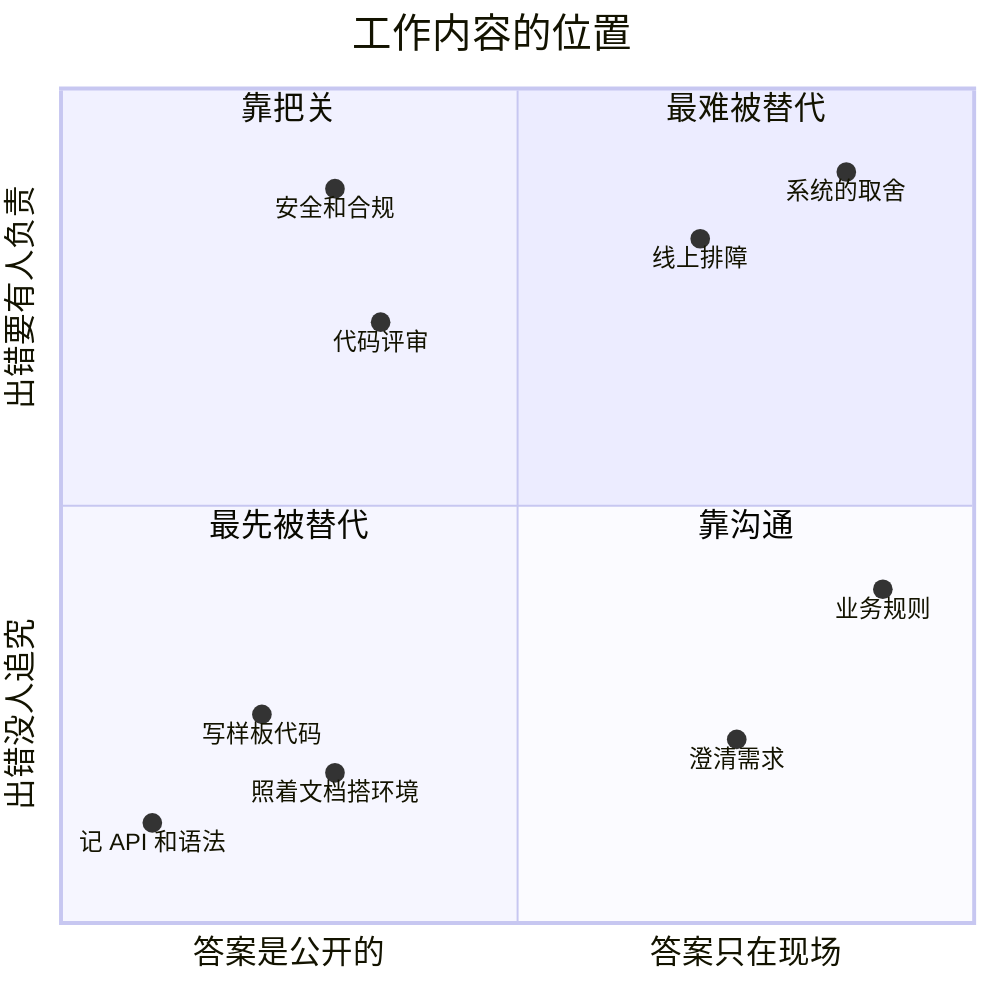
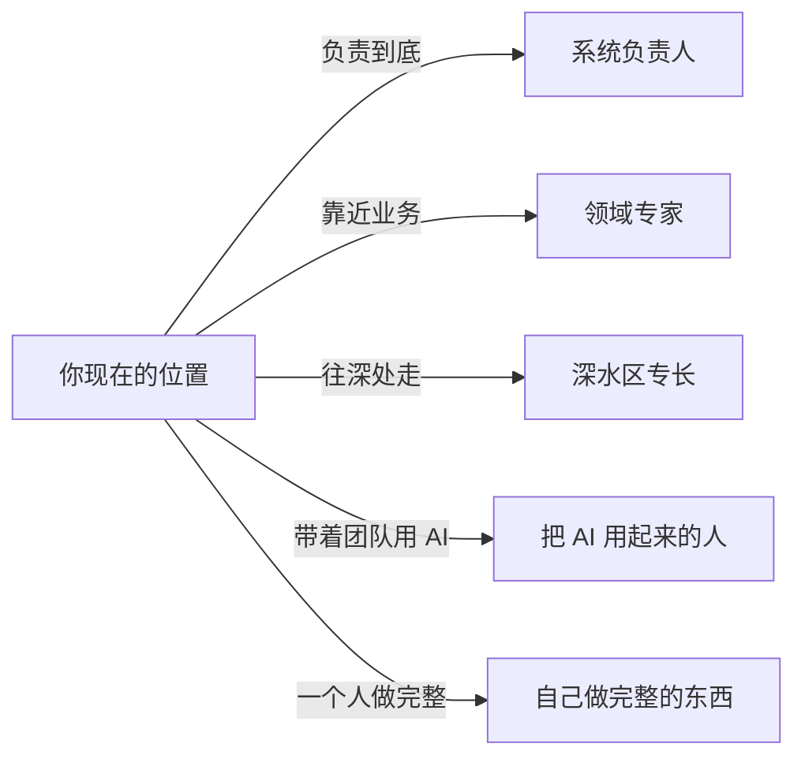

# AI 时代，工程师的出路

> **写给**：工作了好些年、每天都在用 AI 写代码，开始担心饭碗的工程师。
>
> **这篇只讲出路。** 怎么更快地学会新东西，单独做成了一个 skill，见 [skills/learn](../skills/learn/SKILL.md)。
>
> 这是一篇观点文章，写作日期 2026-11-17。引用的研究按下表标注核对程度；其余都是判断，可以不同意。

| 标记 | 含义 |
|---|---|
| 🔎 | 原文网站在写作环境里打不开，只用搜索结果里的多个来源相互印证。引用前请自己点开原文 |
| 🧠 | 我的判断，没有数据支撑 |

---

## 0. 先说结论

1. **AI 比你懂得多，这是事实，不用和它比。**
2. **知识降价了，值钱的东西换了**：从「知道答案」，变成判断对错、对结果负责、掌握只在现场才有的信息。
3. **到目前为止，冲击落在只有书本知识的人身上**，有经验的人基本没受影响。这条线会不会往上移，没人知道。
4. **出路有五条**，共同点是离「只在现场才有的信息」和「出了事要有人负责」更近。大多数人走其中一两条的组合。
5. **不管走哪条，都要一直学得动。** 方法在 [学习 skill](../skills/learn/SKILL.md) 里。

---

## 1. 什么在降价，什么在涨价

一件工作值不值钱，可以看两件事：它的答案是公开的，还是只在现场才有；它做错了，有没有人要负责。

左下角最先被替代：答案是公开的，做错了也不太要紧，AI 做得又快又好。右上角最难被替代：答案只在你们这里，做错了要有人签字负责。

| 在降价 | 在涨价 |
|---|---|
| 记得住 API、语法、配置项 | 知道一段代码放进**这个系统**会不会出事 |
| 熟悉某个具体框架 | 看得懂框架背后的原理，换一个也能判断 |
| 从零写到能跑的速度 | 从能跑到能上线、能维护的把关 |
| 「我知道这个怎么做」 | 「我知道该不该做、先做哪个」 |
| 写增删改查 | 把含糊的需求变成能验收的任务 |
| 一个人闷头写 | 对一件事从头到尾负责，包括上线之后 |

---

## 2. 数据说了什么

**初级岗位确实在变少。** 斯坦福数字经济实验室用美国的薪资数据做过一项研究 🔎（2025 年 8 月首发，11 月修订）：在最容易受 AI 影响的职业里，22 到 25 岁的人就业相对下降了 13%，修订版里这个数字是 16%；这个年龄段的软件开发岗位，比 2022 年底的高点少了近两成。同样的职业里，有经验的人就业稳定，甚至还在增长。

作者自己提醒，这不全是 AI 造成的。他们 2026 年 2 月的补充说明提到，更严格地控制其他因素之后，下降只在 2024 年以后才显著 🔎。

报道里对这个现象的一种解释是：AI 替代的是书本上学得到的知识，替代不了干出来的经验，而刚毕业的人手里主要是前者 🔎。

**别用感觉衡量自己。** METR 在 2025 年上半年做过一个实验 🔎：有经验的开源开发者在自己熟悉的项目里，用 AI 的任务实际多花了 19% 的时间，他们自己却觉得快了大约 20%。这个结论已经过时，METR 2026 年 2 月的后续说新一轮数据因为样本有偏，给不出可靠的估计 🔎。今天仍然成立的是：**感觉自己变强了多少，和实际变强了多少，可以差得很远。** 要用做成了什么来衡量。

---

## 3. 你手里的经验，哪部分值钱

不是写过的代码量，那部分正是 AI 最擅长的。值钱的是四样：

| 值钱的 | 为什么 AI 给不了 | 问问自己 |
|---|---|---|
| **见过的事故** | 事故的细节很少写进公开资料 | 我能说出三次印象最深的线上事故，以及它们是怎么被发现的吗 |
| **做过的取舍** | 取舍取决于当时的人、钱、时间，资料里只有结果 | 我能说清我们的系统为什么是现在这样，而不是另一种样子吗 |
| **负过的责** | 责任没法外包给不能签字的东西 | 出了问题，有没有人会第一个来找我 |
| **只在这里才有的信息** | 业务规则、系统的历史、谁说了算，不在任何训练数据里 | 新人问我「为什么」时，我答得上来吗 |

如果十年里大部分时间是在重复第一年就会的事，那这部分经验和「一年经验加上 AI」差别不大。值得拿这张表对照一下，看看自己的这些年里，四样各有多少。

---

## 4. 五条路 🧠

| 路 | 你提供的、AI 给不了的 | 适合谁 | 风险 | 下个月就能做的第一步 |
|---|---|---|---|---|
| **系统负责人** | 对一个要紧系统从设计到线上的整体判断，以及出事时的担当 | 喜欢把一件事管到底的人 | 系统下线或者被合并，位置跟着消失 | 主动认领一个要紧但没人管的模块，或者进值班轮换 |
| **领域专家** | 懂技术，也懂一个行业的规矩：支付、物流、医疗、制造…… | 对某个行业有兴趣或已有积累 | 行业本身在萎缩 | 每周和业务方聊一次，把听到的规则写成笔记 |
| **深水区专长** | 在出错代价高、要有人签字的领域里的判断：线上排障、性能、数据一致性、安全 | 喜欢钻难题、能坐得住的人 | 专长太窄，市场上需要的人少 | 参加每一次事故复盘，自己写一份复盘 |
| **把 AI 用起来的人** | 把 AI 接进团队的日常工作，并且配上验证和评审，让整个团队变快 | 喜欢搭工具、改流程的人 | 工具变化很快，经验容易过时 | 把团队里一件重复的活交给 AI，并给它配上检查 |
| **自己做完整的东西** | 从想法到上线、运维、回复用户，一个人负责全部 | 能接受收入不稳定的人 | 做出来没人用 | 做一个有十个人真的在用的小工具 |

这五条不互斥。最常见的组合，是「系统负责人」加上另外一条。

怎么选，看你过去一年里最有成就感的那件事属于哪一类，比看哪条路最热门靠谱。

---

## 5. 不管走哪条都要做的

1. **两种知识都要有。** 只在你们公司才有的知识，保的是这份工作；到哪都用得上的基础，保的是这个职业。只有前一种，离职那天它就归零；只有后一种，你和别人没有区别。
2. **用结果说话。** 借助 AI，一个人能交付以前几个人的东西。让它被看见，靠的是做成的事，不是加班的时长。
3. **保持随时能面试的状态。** 手里有一件拿得出手的东西。面试考的和日常工作用的不完全一样，要找工作时得单独准备。
4. **一直学得动。** 新东西会越来越多，不可能都学深。先定这次学到哪一层，再按固定的流程学，见 [学习 skill](../skills/learn/SKILL.md)。

---

## 6. 不值得花力气的事

- **和 AI 比知识量。** 已经输了，认了就好。
- **追每一个新模型、新工具。** 选一两个用熟，每个季度看一次要不要换。
- **把提示词套路当本事。** 模型每升一代，就有一批套路失效。把话说清楚的能力不会过时。
- **焦虑地囤课。** 收藏和买课带来的是「我在努力」的感觉，不是能力。

---

## 7. 说不准的部分

**整个行业需要多少工程师，没人知道。** 每个人的产出变高之后，可能是软件的需求跟着变大，也可能是岗位变少。

**「有经验就安全」这条线会不会上移，也不知道。** 如果有一天 AI 连判断和验证都做得可靠，留给人的就只剩拿主意和担责任。

所以上面选的，都是两种情况下都不亏的东西：判断力、领域知识、负责到底的习惯、一直学得动。AI 停在今天，它们让你比别人用得好；AI 再强十倍，它们是最后才被替代的部分，换个行业也带得走。

---

## 附：每个季度问自己三个问题

1. 过去三个月，我做成了什么以前做不成的事？
2. 有没有哪件事，出了问题别人会第一个来找我？
3. 我手里只在这里才有的信息，比三个月前多了还是少了？

---

## 来源

- 🔎 Brynjolfsson、Chandar、Chen，*Canaries in the Coal Mine? Six Facts about the Recent Employment Effects of Artificial Intelligence*，2025-11 修订版：<https://digitaleconomy.stanford.edu/app/uploads/2025/11/CanariesintheCoalMine_Nov25.pdf>
- 🔎 斯坦福数字经济实验室，2026-02-09 补充说明：<https://digitaleconomy.stanford.edu/news/canaries-interest-rates-and-timinga-more-on-recent-drivers-of-employment-changes-for-young-workers>
- 🔎 METR，2025 年开发者生产力实验：<https://metr.org/blog/2025-07-10-early-2025-ai-experienced-os-dev-study/>
- 🔎 METR，2026-02-24 后续更新：<https://metr.org/blog/2026-02-24-uplift-update/>
