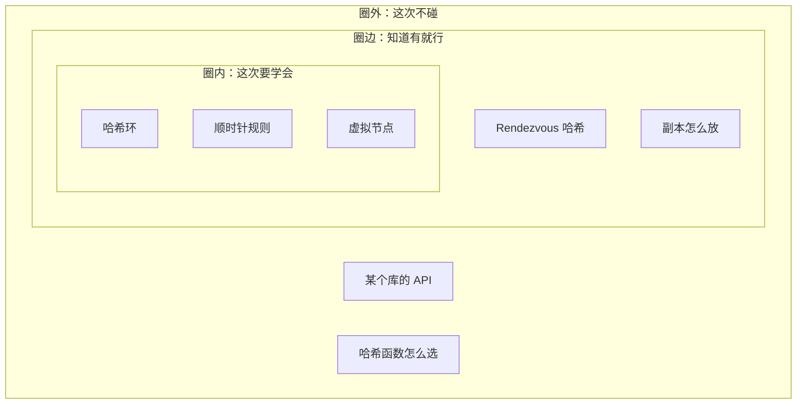
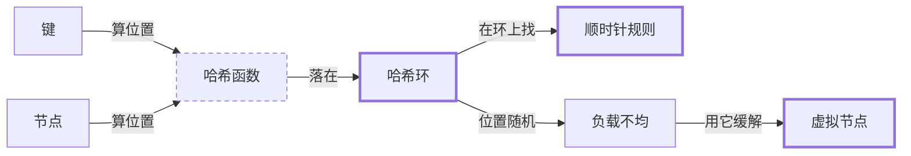
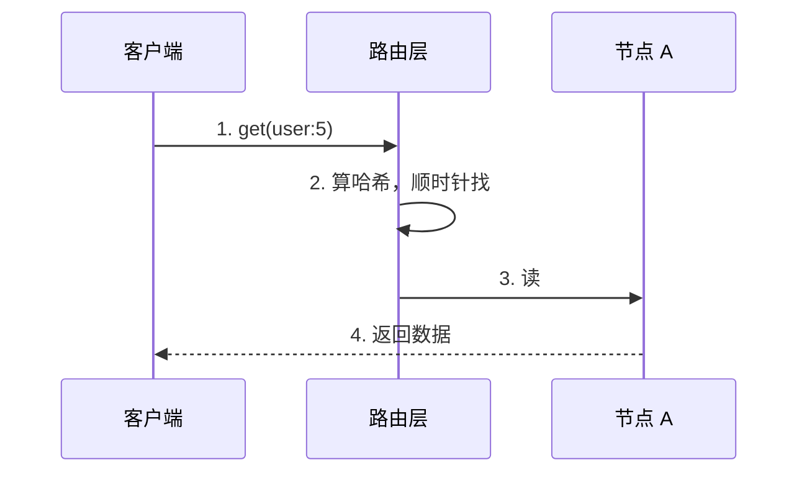
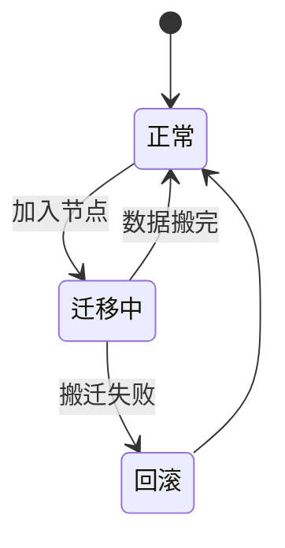
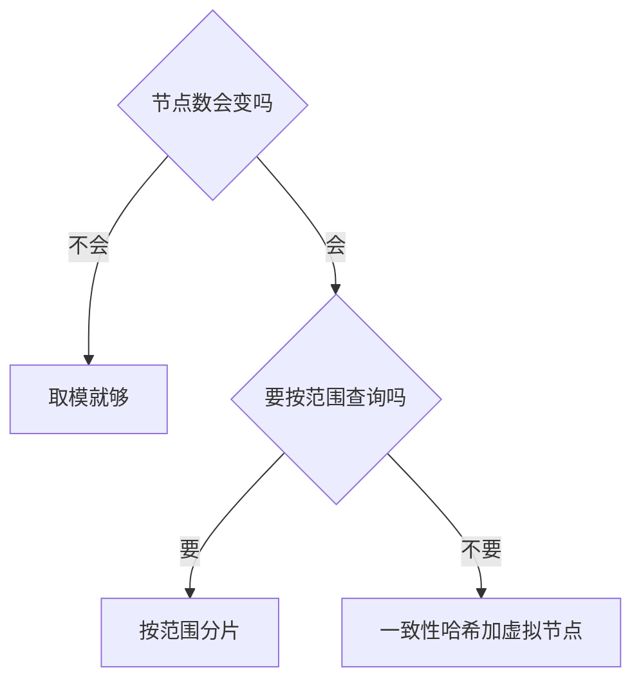
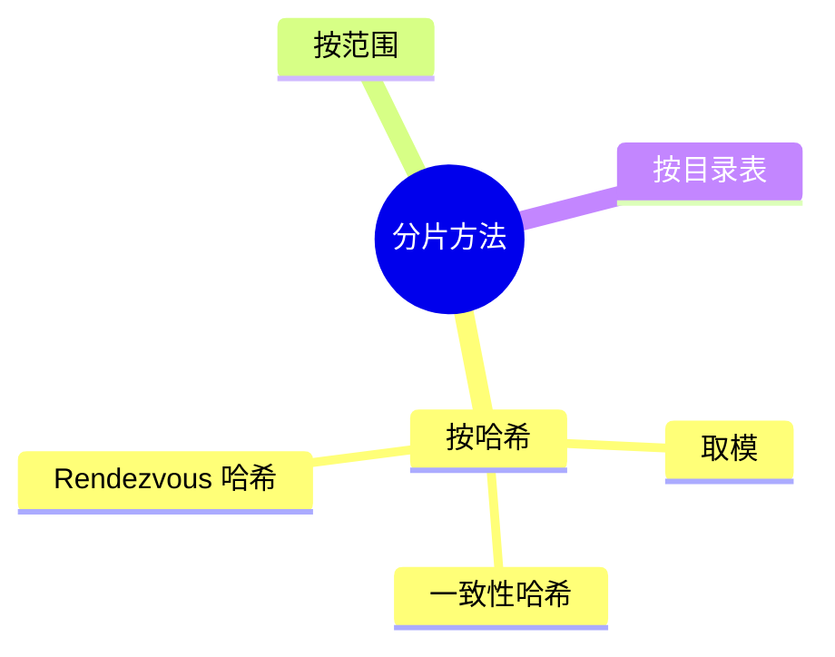
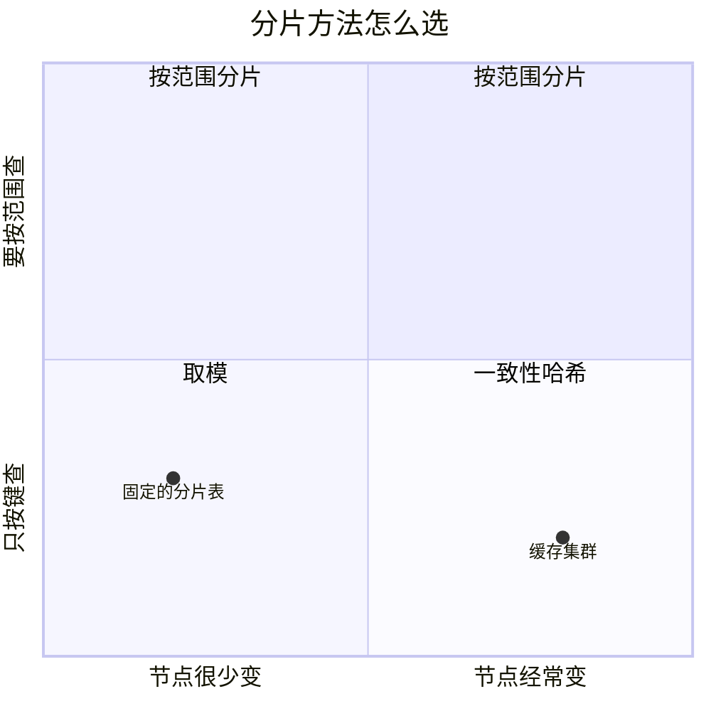

# 图怎么画

先判断知识的形状，再选图。每种图给两种画法：

- **Mermaid**：对话界面、GitHub、大多数 Markdown 预览都能渲染
- **字符画**：在终端里也能看。拿不准对方能不能渲染时，用它

学习页里的图由模板自己画，写数据就行，见 `page-data.md`。

下面的例子都用一个主题：一致性哈希（把数据分到多台机器上的一种办法）。

## 通用规矩

- 一张图只讲一件事。
- 画机制，不画名字。只写着名字的方框什么都没说。
- 每条线上写关系。
- 最多九个节点，再多就拆。
- 说明写在图里对应的位置，或者紧跟在图下面，一两句话。
- 要强调的只有一处时，才用颜色或粗框标它。

## 边界图：哪些算，哪些不算

Mermaid：

````

````

字符画：

```
┌ 圈外：这次不碰 ─────────────────────────────┐
│  某个库的 API · 哈希函数怎么选              │
│ ┌ 圈边：知道有就行 ───────────────────────┐ │
│ │  Rendezvous 哈希 · 副本怎么放           │ │
│ │ ┏ 圈内：这次要学会 ━━━━━━━━━━━━━━━━━━━┓ │ │
│ │ ┃  哈希环 · 顺时针规则 · 虚拟节点      ┃ │ │
│ │ ┗━━━━━━━━━━━━━━━━━━━━━━━━━━━━━━━━━━━━━┛ │ │
│ └─────────────────────────────────────────┘ │
└─────────────────────────────────────────────┘
```

## 概念图：有哪几块，彼此什么关系

Mermaid。核心节点加粗，前置知识用虚线：

````

````

字符画：

```
 键 ──算位置──▶ 哈希函数 ◀──算位置── 节点
                  │
                 落在
                  ▼
              【哈希环】 ──在环上找──▶ 【顺时针规则】
                  │
               位置随机
                  ▼
              负载不均 ──用它缓解──▶ 【虚拟节点】

 【】是这次的核心
```

## 时序图：先后发生了什么

````

````

在对话里分步讲时，每条消息只多画一步，并用文字标出这一步新增的是哪条线。

## 分步图：同一张图，每一步变一处

适合讲状态如何一步步变化。每一步重画整张图，变化的地方用 `*` 或「（新）」标出：

```
第 1 步：三个节点        第 2 步：加入 D
     A                        A
   /   \                    /   \
  C     B                  C     B
                            \   /
                             D*      D 只接管 C 到 D 之间那一段
```

## 状态图：在几种状态之间怎么变

````

````

## 对照表：两三种做法差在哪

用表格。行是要比较的方面，列是做法，最后一行写「什么时候选它」。

| | 取模分片 | 一致性哈希 |
|---|---|---|
| 一个键去哪 | `hash % N` | 顺时针第一个节点 |
| 加一台机器 | 大约 3/4 的键要搬 | 平均搬 1/(N+1) |
| 负载是否均匀 | 均匀 | 不一定，要靠虚拟节点 |
| 什么时候选它 | 节点数固定 | 节点经常增减 |

## 决策树：什么情况选什么

````

````

## 数量：多少，怎么变化

数字必须算出来。能跑代码就跑，并在图下面写一句数字是怎么得到的。

对话里，用表格或者字符条形图：

```
每个节点占 1 个点          每个节点占 128 个点
A ███████████████ 51%      A █████████ 31%
B █████████ 30%            B ██████████ 34%
C █████ 18%                C ██████████ 34%
```

## 树：大类下面有什么

````

````

## 象限图：两个维度上各放在哪

适合讲「什么情况选什么」或者「哪些东西落在哪一类」。Mermaid 的象限图对中文很挑：轴、象限和点的名字都要加引号，标题不加。

````

````

## Mermaid 的中文写法

- 节点文字一律放进引号：`A["哈希环"]`，不要写 `A[哈希环]`。
- 连线上的字用 `-->|文字|`。
- 括号、冒号、引号这些符号放在节点文字里容易出错，能不用就不用。

## 渲染不了怎么办

Mermaid 显示成了源码，说明这个界面不渲染，下一张起改用字符画。

字符画里的中文占两个字符宽，对齐时按这个算。框线字符（`┌ ─ │`）和 `·` 在一些中文字体里也会显示成两格宽，所以右边框最容易歪。拿不准时，去掉右边框，只留左边框和标题，比歪掉的框好读。
